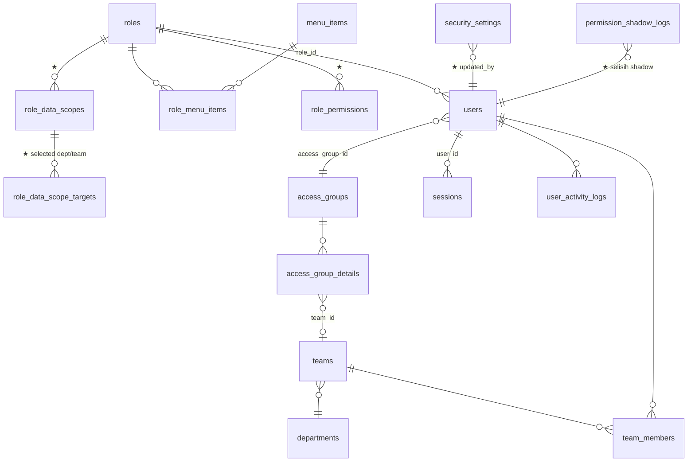

# Blueprint — Centralized Security & Access Control TESYS

- Tanggal: 2026-11-06 · Branch saat audit: `update/v3.3.2`
- Disusun oleh: sesi utama berperan **Planner** (`.claude/roles/planner.md`), read-only.
  Subagent `planner` **tidak** dipanggil; Executor/Reviewer/Evaluator **belum** berjalan.
- Status: **D1 DISETUJUI pemilik 2026-11-07** ("Setujui D1, mulai Fase 0"). Butir §9 lainnya
  masih menunggu keputusan. Fase 0 dikerjakan mulai 2026-11-07.
- Klasifikasi keseluruhan: **HIGH** (otorisasi, CLAUDE.md §8/§20) dengan beberapa butir
  **CRITICAL** (autentikasi, alur pembayaran).

## 0. Prinsip pengikat dari pemilik

> **Plan ini tidak boleh mengubah workflow atau UX yang sudah ada.** Setiap butir yang
> mengubah perilaku yang dilihat/dialami user (status, tahap, siapa yang boleh, tombol, menu,
> layar login, lama sesi, pesan, notifikasi, Todo List) **dikeluarkan dari scope default**,
> diberi label **HIGH — KEPUTUSAN PEMILIK**, dan dikumpulkan di §9.

Konsekuensi desain:
1. **Parity first.** Mesin otorisasi baru diisi (seed) dari aturan yang berlaku sekarang,
   sehingga hasil keputusannya identik dengan kode lama. Perubahan aturan baru terjadi setelah
   administrator mengubah konfigurasi secara sadar.
2. **Shadow mode sebelum enforce.** Mesin baru berjalan berdampingan dengan gerbang lama,
   mencatat setiap selisih, tanpa memengaruhi respons. Gerbang lama baru dicabut per modul
   setelah selisih = 0 dan disetujui.
3. **Additive only.** Tabel/kolom baru saja; tidak ada drop, tidak ada perubahan FK lama,
   tidak ada backfill yang mengubah data transaksi.
4. **Halaman baru hanya untuk superadmin** (konsol keamanan). Layar user biasa tidak berubah.

---

## Deliverable 1 — Audit arsitektur saat ini (dengan bukti)

### 1.1 Lapisan otorisasi yang berjalan

| Lapisan | Implementasi | Bukti |
|---|---|---|
| Autentikasi | Session guard, `Auth::attempt` + `status=ACTIVE` di kredensial | `AuthController.php:116-123` |
| Gerbang role | `role:a,b` → `CheckRole` → `User::hasRole()` (memakai `effectiveRole()`, View As) | `CheckRole.php:21-53`, `User.php:291-330` |
| Gerbang menu | `menu:key` → `CheckMenu` → `Role::hasMenu()` (tabel `role_menu_items`), superadmin bypass | `CheckMenu.php:27-60`, `Role.php:45-55` |
| Cek di controller | `hasRole()` 122 pemanggilan di `app/`, literal `role->name` 79 tempat | grep 2026-11-06 |
| Cek di Blade | `hasRole()` 109 pemanggilan di `resources/views` | grep 2026-11-06 |
| Konstanta kewenangan | `App\Support\AccessRoles` (PO, Beneficiary, Trouble Ticket, Site) | `AccessRoles.php:28-196` |
| Tahap approval | `BudgetRequest::STAGE_ROLES`, `SETTLE_BULK_ROLES` | `BudgetRequest.php:1109-1127` |
| Visibilitas data | Access Group individu ∪ team ACTIVE (`accessibleProjectIds/CostCenterIds`), `scopeByRole`, `findVisibleCr`, `ScopesBudgetPlanVisibility`, `ScopesInvoiceVisibility`, `TroubleTicket::scopeVisibleTo`, `SiteController::visibleCustomerIds` | `User.php:430-530`, `BuildsCrWorklist.php:29`, `BudgetRequestController.php:109,138` |
| File | `SecureFileController` → `FileAccess::allows()`, default **tolak** | `FileAccess.php:52,132` |
| Akun nonaktif | `EnsureUserActive` memutus sesi seketika | `EnsureUserActive.php:25-60` |
| Header | `SecurityHeaders` (XFO, nosniff, Referrer, Permissions, HSTS bila https; **tanpa CSP**) | `SecurityHeaders.php` |

Catatan penting: route dikelompokkan; 34 kunci `menu:` dan ±26 kombinasi `role:` berbeda di
`routes/web.php` (1.487 baris). Tidak ada Policy/Gate Laravel (sesuai CLAUDE.md §3).

### 1.2 Skema relevan

- `roles` (id, name, status) — **tidak ada UI tambah role**; role dari `RoleSeeder`. `RoleController` hanya
  index + atur menu (`RoleController.php`, route `role:superadmin` `web.php:1314-1319`).
- `users` (role_id **tunggal**, access_group_id **wajib**, status, remember_token, …) — tidak ada
  `department_id`, `last_login_at`, `password_changed_at`, `locked_until`.
- `menu_items` (key, label, icon, route, section, sort_order) + `role_menu_items` (pivot, cascade).
  Susunan sidebar & modal akses dibaca dari `config/navigation.php` + `config/apps.php` lewat
  `App\Support\Navigation`; kunci baru masih perlu migrasi `insert menu_items` (15 migrasi seperti itu).
- `access_groups`, `access_group_details` (project_id | cost_center_id | team_id).
- `teams` (department_id, leader_id, parent_team_id, customer_id), `team_members` (is_primary, position, level),
  `team_customers`, `team_logs`, `departments` (code, name, status).
- **Tidak ada** Company / Division / Position master. `employees` tidak terhubung ke `users`.
- **Tabel transaksi tidak menyimpan team/department pemilik**; kepemilikan = `applicant_id` /
  `created_by`/`input_by` (beragam per modul) + Project/Cost Center.
- `sessions` (driver database: user_id, ip_address, user_agent, last_activity) — sudah ada.
- `user_activity_logs` (user, actor_name/role, module, action, description, changes JSON, subject, reference,
  ip_address, created_at) — **tanpa** user_agent / session id; dipakai ±40 file.
- Log status per dokumen: `request_status_logs`, `project_logs`, `budget_plan_logs` (+ `actor_org_context`).

### 1.3 Autentikasi & sesi

- Throttle login per username+IP 5×/300 dtk (`AuthController.php:22,25,83-101`) + `throttle:20,1` per IP (`web.php:54`).
- Password: min 10, huruf + angka (`UserController.php:152,387`, `ProfileController.php:351`), bcrypt (`Hash::make`).
- Lupa sandi via kode email, hash di cache, maks 5 coba, TTL 15 mnt (`AuthController.php:193-300`).
- Login sukses/ logout dicatat `UserActivityLog`; **login gagal & lockout hanya ke `laravel.log`** (`:89,146`).
- Sesi: `SESSION_LIFETIME` default 120, `encrypt=false`, `same_site=lax`, "remember me" aktif (`config/session.php`).
- Tidak ada 2FA, notifikasi login, daftar sesi aktif, revoke sesi, logout semua perangkat.

### 1.4 Menu

- Sudah **semi-dinamis**: struktur di config (bukan DB), hak per role di DB. Menu tanpa `menu`/`roles`
  tampil untuk semua user login. Beberapa item dijaga `roles` (mis. `config/navigation.php:193,217`).
- `CheckMenu` = logika sidebar (komentar `CheckMenu.php:16-18`) → menu tampil ≡ halaman bisa dibuka,
  **tetapi** aksi di dalam halaman dijaga `role:` terpisah.

### 1.5 Akses PO (lihat juga `docs/plans/2026-11-06-team-akses-organisasi.md`)

PO_FULL_SCOPE (7 role) lihat semua; lainnya Access Group individu ∪ team ACTIVE; read-only untuk
dokumen yang pernah ditindak. Hierarki tidak mewariskan akses (K3).

### 1.6 Approval

Tahap & role hardcoded per modul (CR `STAGE_ROLES`, Budget Plan, PO, Treasury, Invoice, Cost Register,
Trouble Ticket via `TroubleTicketWorkflow::canSupervise` berbasis leader team). Sebagian transisi CR
memakai `transitionStatus()` (row lock), sebagian tidak (CLAUDE.md §5). Tidak ada threshold nominal,
delegasi, atau pemisahan tugas umum; pengecualian: Trouble Ticket melarang approve Closed miliknya sendiri.

### 1.7 Temuan keamanan & utang teknis (dilaporkan, tidak diubah)

| # | Temuan | Level | Sumber |
|---|---|---|---|
| T1 | Tidak ada pemeriksaan **self-approval** (pengaju = approver) di CR/BP/Treasury/Invoice | HIGH | `docs/security.md` temuan 1 |
| T2 | `superadmin` lolos semua gerbang termasuk pembayaran & approval | HIGH | `docs/security.md` temuan 2 |
| T3 | Closing hanya `menu:closing`, tanpa role gate | MEDIUM | temuan 5 |
| T4 | API ekspor publik mengembalikan **semua** CR tanpa Access Group (by design) | HIGH | `web.php:1461-1487` |
| T5 | Login gagal/lockout tidak masuk audit trail yang bisa dibaca dari aplikasi | MEDIUM | `AuthController.php:89,146` |
| T6 | Kewenangan tersebar: 122 `hasRole` di app + 109 di Blade + 79 literal nama role | MEDIUM (utang) | grep |
| T7 | Tidak ada pencatatan 403 / percobaan akses ditolak | MEDIUM | `CheckRole`, `CheckMenu` |
| T8 | Perubahan menu role hanya mencatat selisih ke `laravel.log`; `UserActivityLog` tanpa `changes` | LOW | `RoleController.php:104-120` |
| T9 | Tidak ada CSP (sengaja, 176 skrip inline) | MEDIUM (diketahui) | `SecurityHeaders.php:13-17` |
| T10 | Revoke sesi "remember me" butuh rotasi `remember_token`; belum ada jalur | MEDIUM | `config/session.php` |
| T11 | Notifikasi tahap Head ke semua Head (bocor kode/deskripsi CR lintas unit) | MEDIUM | blueprint team §12 |
| T12 | Cash Receipt delete boleh approver/collection/treasury | MEDIUM (Needs confirmation) | temuan 7 |
| T13 | Backup: hanya prosedur manual di `docs/DEPLOYMENT.md:180-194`; jadwal, retensi, uji restore **UNKNOWN** | HIGH (operasional) | DEPLOYMENT.md |

---

## Deliverable 2 — Gap analysis (12 domain)

| Domain | Kondisi sekarang | Gap | Risiko | Prioritas |
|---|---|---|---|---|
| 1 Autentikasi | Throttle akun+IP, bcrypt, policy 10 char, reset via kode, status di kredensial | Tidak ada 2FA, notifikasi login, deteksi login mencurigakan; login gagal tak di audit trail; parameter hardcoded | Brute force terdistribusi tak terlihat | P1 (audit) / P3 (2FA = keputusan) |
| 2 User Management | CRUD superadmin, status ACTIVE/INACTIVE langsung berlaku, 1 role, 1 AG wajib | Tanpa account expiration, access review, last login, multi-role, employee mapping | Akun lama/akun kedaluwarsa tetap aktif | P2 |
| 3 Role & Permission | Role tetap (seeder); permission = menu + daftar role hardcoded | Tidak ada permission granular (view/create/edit/delete/approve…) yang bisa diatur; tidak bisa buat role baru | Setiap perubahan kewenangan butuh deploy kode | P1 |
| 4 Organisasi | Department, Team (hierarki tampilan), leader; tanpa Company/Division/Position | Org tidak terhubung ke transaksi; tidak ada reporting line formal | Scope departemen tidak bisa diterapkan tanpa data | P3 |
| 5 Data scope | Access Group (project/cost center) + team; role full scope; own (applicant) di CR | Scope tidak bisa dikonfigurasi per modul/ability; tidak ada scope Department/Division | Bergantung pada kode per modul; risiko inkonsistensi list/detail/export | P1 |
| 6 Menu | Struktur config, hak DB, sidebar ≡ CheckMenu | Tidak bisa toggle/urut dari UI; menu baru butuh migrasi + config | Rendah (menu bukan enforcement) | P3 |
| 7 Approval authority | Hardcoded per modul | Tanpa threshold, delegasi, SoD; tidak terlihat di satu tempat | Self-approval mungkin | P2 (registry baca-saja) / keputusan |
| 8 Audit trail | `user_activity_logs` immutable, ±40 file memakai | Tanpa user_agent/session; login gagal, 403, ekspor, unduh, perubahan permission tidak lengkap | Forensik lemah | P1 |
| 9 Sesi & perangkat | Tabel `sessions` ada, deactivate memutus sesi | Tidak ada daftar sesi, revoke, logout semua, kebijakan konkuren | Sesi curian tak bisa dicabut selain nonaktifkan akun | P1 |
| 10 Security settings | Semua di kode/.env | Tidak ada halaman pengaturan terpusat | Perubahan butuh deploy | P2 |
| 11 Backup & recovery | Prosedur manual di docs | Jadwal, retensi, enkripsi, uji restore UNKNOWN | Kehilangan data | P1 (audit dokumen, bukan kode) |
| 12 Monitoring | `laravel.log` + activity log | Tidak ada dashboard/alert | Insiden terlambat diketahui | P2 |

---

## Deliverable 3 — Arsitektur usulan

### 3.1 Bentuk komponen (mengikuti pola TESYS, tanpa Policy/Repository)

| Komponen | Lokasi | Peran |
|---|---|---|
| Registry permission | `config/permissions.php` (pola `config/navigation.php`) | Daftar modul → ability (`view`, `create`, `edit`, `delete`, `export`, `approve.head`, …), label, default role seed. **Kode** yang mendefinisikan *apa yang ada*; DB menyimpan *siapa yang boleh*. |
| Penyimpan hak | tabel `role_permissions` | role_id × permission_key |
| Mesin | `App\Support\Authorizer` (pola `AccessRoles`, single source) | `allows(User, key)`, memo per request, superadmin & View As mengikuti aturan lama |
| Middleware | `perm:key` → `CheckPermission` (pola `CheckMenu`) | Dipasang **berdampingan** dengan `role:` selama shadow mode |
| Data scope | tabel `role_data_scopes` + `App\Support\DataScope` | `DataScope::apply($query, $user, 'cost_request', 'view')` **membungkus** fungsi scope yang sudah ada |
| Approval registry | `config/approval_authority.php` | Membaca `STAGE_ROLES` dsb. untuk ditampilkan; tidak mengubah transisi |
| Security settings | tabel `security_settings` (key, value JSON, updated_by) + `App\Support\SecuritySettings` | Nilai default = nilai saat ini, ada batas bawah keras |
| Audit | `user_activity_logs` + kolom baru | satu tabel audit (tidak membuat tabel kedua) |
| Konsol | `SecurityController` + view `security/*` | superadmin only |

`Authorizer`, `DataScope`, `SecuritySettings`, `CheckPermission` = **layer baru** → wajib persetujuan
(CLAUDE.md §3) → **Keputusan D1**.

### 3.2 ERD (tambahan ditandai ★)

★ Tabel baru:
- `role_permissions` (id, role_id FK RESTRICT, permission_key varchar(100), created_by, timestamps; unique role_id+key)
- `role_data_scopes` (id, role_id, module varchar(40), ability varchar(40), scope varchar(30), timestamps; unique role_id+module+ability)
- `role_data_scope_targets` (scope_id, target_type `department|team`, target_id) — hanya bila D4 disetujui
- `security_settings` (key unique, value JSON, updated_by, updated_at)
- `permission_shadow_logs` (id, user_id, permission_key, route, legacy_result, engine_result, created_at) — sementara, dihapus manual setelah cutover

★ Kolom baru (nullable): `user_activity_logs.user_agent` (varchar 255), `user_activity_logs.session_hash`
(sha256 id sesi, bukan id mentah); `users.last_login_at`, `users.last_login_ip`.

### 3.3 Jenis data scope yang **didukung data saat ini**

| Scope | Tersedia sekarang? | Sumber |
|---|---|---|
| ALL (All Company) | Ya | role full scope |
| ACCESS_GROUP (project/cost center; individu ∪ team) | Ya — perilaku default saat ini | `accessibleProjectIds/CostCenterIds` |
| OWN (pengaju/pembuat) | Ya untuk CR (`applicant_id`); modul lain per kolom `created_by`/`input_by` — dipetakan per modul | per model |
| ACTED_ON (baca-saja) | Ya (CR, PO) | `wasActedOnBy()` |
| ASSIGNED (PIC/assignee) | Sebagian: Trouble Ticket, Assignment, Site PIC | per modul |
| OWN_TEAM / OWN_DEPARTMENT / SELECTED / DIVISION | **Tidak** — transaksi tidak menyimpan team/department; Division tidak ada | butuh D4 |

Definisi istilah (untuk dokumen modul): **Created By** = user yang menyimpan baris pertama;
**Owner/Applicant** = penanggung jawab dokumen (CR: `applicant_id`); **PIC** = penerima/pelaksana
lapangan (`master_pics`, `beneficiary.pic`); **Assignee** = penerima tugas eksplisit (Assignment,
Trouble Ticket); **Organizational Owner** = unit pemilik (belum ada kolomnya). Per modul dicek di Fase 0.

### 3.4 Aturan keputusan mesin (secure by default)

1. Tidak login → tolak. Akun tidak ACTIVE → `EnsureUserActive` (tetap).
2. Permission key tidak terdaftar di registry → **tolak** + log (default deny).
3. superadmin → perilaku saat ini dipertahankan (lolos), kecuali D12 diputuskan lain.
4. View As → memakai `effectiveRole()` persis seperti `hasRole()` sekarang; tidak pernah menambah hak tulis.
5. `view` tidak menyiratkan `edit/delete/approve`; tiap ability dicek sendiri.
6. Data scope diterapkan di **query** (list, detail, export, AJAX, file) lewat satu fungsi; detail/aksi tetap
   lewat `findVisibleCr` dkk. yang sudah ada sampai cutover.

---

## Deliverable 4 — Strategi migrasi

1. **Seed parity.** Migrasi data menulis `role_permissions` & `role_data_scopes` dari daftar `role:` pada route
   dan konstanta `AccessRoles`/`STAGE_ROLES` saat ini — hasil tiap kombinasi (role × permission) = keputusan
   kode lama. Tidak membaca/mengubah tabel transaksi.
2. **Golden matrix test.** Sebelum seed dipakai, test karakterisasi merekam matriks akses saat ini
   (route × role → 200/403/redirect) dan dipakai ulang setelah tiap fase: hasil harus identik.
3. **Shadow mode.** `CheckPermission` dipasang dengan mode `observe` (config `security.enforce.<module> = false`):
   menghitung hasil mesin, membandingkan dengan gerbang lama, menulis selisih ke `permission_shadow_logs`,
   **tidak** memengaruhi respons. Satu insert hanya saat berbeda (beban rendah).
4. **Cutover per modul** (urut risiko rendah → tinggi: Master Data → Report → Budget Plan → PO → Invoice →
   CR → Treasury). Syarat: selisih 0 selama periode UAT (2 minggu untuk CR & Treasury, 1 minggu modul lain — keputusan 2026-11-07), golden test lulus, persetujuan
   tertulis. Gerbang `role:` lama **tetap di route** sampai satu rilis setelah cutover.
5. **Tidak membuka akses lebih luas selama migrasi**: bila mesin dan gerbang lama berbeda, yang berlaku
   adalah **yang lebih ketat** (AND), bukan yang lebih longgar.
6. **Rollback**: (a) set `security.enforce.<module>=false` → kembali ke gerbang lama tanpa deploy ulang kode;
   (b) semua migrasi additive dengan `down()` yang men-drop tabel/kolom baru saja; (c) data transaksi tidak
   disentuh sehingga tidak ada rollback data.
7. Ownership transaksi **tidak diubah** dan tidak di-backfill.

---

## Deliverable 5 — Roadmap

Urutan disesuaikan dari usulan prompt: audit & sesi didahulukan karena additive dan menjadi alat ukur
untuk fase berikutnya. Setiap fase berakhir dengan laporan Executor + Reviewer.

### Fase 0 — Inventaris & baseline (LOW, read-only + test) — **SELESAI 2026-11-07**
- Hasil: `docs/security/access-matrix.md` (temuan F-1…F-5), `tests/Fixtures/security/route-gates.json`,
  `scripts/security/route-gates-snapshot.php`, `tests/Feature/Security/{RouteGateSnapshotTest,AccessBaselineTest}.php`.
  Nama file test berbeda dari rencana awal (`AccessMatrixBaselineTest`) — dipecah dua agar uji snapshot tanpa DB.
  Test **belum dijalankan** (menunggu permintaan + prosedur CLAUDE.md §4.3).
- Scope: hasilkan matriks route → middleware → controller check → Blade condition per modul (dari
  `routes/web.php` & grep), daftar kolom owner per modul, daftar export/AJAX/download endpoint.
- File baru: `docs/security/access-matrix.md`, `tests/Feature/AccessMatrixBaselineTest.php`.
- DB: tidak ada. Risiko: LOW. Rollback: hapus file.
- Acceptance: setiap route ber-`{id}` tercatat beserta fungsi visibilitasnya; baseline test merekam ≥1
  role diizinkan & ≥1 role ditolak per grup route.

### Fase 1 — Fondasi audit & sesi (MEDIUM, additive; UX user biasa tidak berubah) — **DIIMPLEMENTASI 2026-11-07**
- Dikerjakan: migrasi `2026_11_07_000500`, login gagal/lockout/last login, rincian perubahan di User/Role/Access Group,
  konsol `/security` (Audit Trail, Riwayat Login, Sesi Aktif, cabut sesi, putus semua perangkat), test
  `tests/Feature/Security/SecurityConsoleTest.php` (belum dijalankan).
- **Tidak** dikerjakan (masih keputusan): pencatatan export/download (D18), pencatatan 403 (D11). Konsol tidak ditaruh
  di sidebar (D9/D10) — cukup tombol "Keamanan" di halaman User & Access, hanya untuk superadmin.
- Team tidak diubah: `TeamController` sudah punya `team_logs` + `UserActivityLog`.
- Migrasi: kolom `user_agent`, `session_hash` di `user_activity_logs`; `last_login_at`, `last_login_ip` di `users`.
- `UserActivityLog::record()` mengisi kolom baru; `AuthController` mencatat `login_failed`, `lockout`
  (username dicatat sebagai teks, tanpa password); `RoleController::update`, `UserController`, `AccessGroupController`,
  `TeamController` mengisi `changes` before/after.
- Pencatatan ekspor & unduh lampiran (`SecureFileController`, endpoint `*/export`) sebagai action `export`/`download`.
- Konsol superadmin (halaman baru, menu baru `security-console` via `config/navigation.php`):
  Audit Trail (filter), Login History, **Sesi Aktif** (dari tabel `sessions`), tombol **Cabut sesi** /
  **Logout semua perangkat** (hapus baris `sessions` user + rotasi `remember_token`).
- Risiko: MEDIUM (+1 query insert pada login gagal; tidak ada di jalur request biasa).
- Test: login gagal tercatat; revoke → request berikutnya user tsb redirect login; non-superadmin 403 ke konsol.
- Rollback: `down()` drop kolom; matikan menu.

### Fase 2 — Registry & mesin permission, shadow mode (HIGH, butuh D1) — **DIIMPLEMENTASI 2026-11-07**
- Registry `config/permissions.php` (dibangkitkan `scripts/security/permissions-registry.php`): **1 permission per route
  bergerbang `role:`** (223), kunci = nama route (atau `METHOD /uri`). Lapis `menu:` tidak masuk registry — akses halaman
  tetap `role_menu_items`. Label modul/permission bisa dirapikan di Fase 3.
- `role_permissions` (+ `revoked_at`: pencabutan tidak menghapus baris, jadi sinkron tidak menghidupkannya lagi),
  `permission_shadow_logs`. Migrasi `2026_11_07_000600` (tabel) & `000700` (isi parity dari `seed_roles`).
- `App\Support\Authorizer`: `allows()` (effectiveRole, tanpa bypass superadmin — sama dengan `hasRole()`, default deny),
  `legacyAllows()`, `syncSeed()`; command `security:sync-permissions` (bawaan dry-run, `--apply` untuk menulis).
- `ShadowPermission` (grup web) membandingkan & mencatat selisih bila `SECURITY_PERMISSION_MODE=shadow`
  (`config/security.php`, bawaan `off` → nol query). Tidak pernah mengubah respons.
- Konsol Keamanan: tab **Shadow Permission** (selisih 14 hari per permission/role).
- Test: `PermissionRegistryTest` (registry = gerbang route), `AuthorizerParityTest` (223 permission × semua role identik
  dengan gerbang lama, View As, sinkron, shadow tidak mengubah respons).
- Urutan deploy: upload → `migrate` → `optimize:clear` → (cek tab Shadow: baris role_permissions > 0) →
  `SECURITY_PERMISSION_MODE=shadow` di `.env` → `config:clear`. Bila ada role yang dibuat setelah migrasi:
  `php artisan security:sync-permissions` (dry-run) lalu `--apply`.
- Catatan review 2026-11-07 (sudah ditangani: dedupe log tanpa tabel cache, peringatan seed 0 baris, shadow diam bila
  tabel belum ada, pesan CA diperjelas). Sisa yang perlu diketahui:
  - **Jangan rollback migrasi `000700` setelah ada pencabutan hak** — `down()` mengosongkan role_permissions termasuk
    tanda `revoked_at`.
  - Dua role di DB yang hanya beda huruf besar (mis. `Finance` & `finance`) akan memberi selisih shadow palsu.
  - D18 belum mencakup unduhan Trouble Ticket yang tidak lewat `/storage` (`TroubleTicketController::download`,
    kwitansi PDF, `downloadRequestAttachment`).
  - Potential future improvement: `BudgetRequestController::downloadDetailTemplate` menulis label sub-item Budget Plan
    mana pun tanpa cek visibilitas (sejenis F-3); `ca-quota` masih terbuka.
  - F-5: draft Cash Advance dari approval biasa Trouble Ticket tetap dibuat tanpa cek syarat, lalu tertahan saat
    simpan/submit sampai Token PIC diisi. Hitung dampaknya di produksi sebelum rilis.
- File baru: `config/permissions.php`, `app/Support/Authorizer.php`, `app/Http/Middleware/CheckPermission.php`,
  migrasi `role_permissions`, `permission_shadow_logs`, seed parity.
- `bootstrap/app.php` alias `perm`. Route **ditambah** `perm:` di samping `role:` (tidak mengganti).
- Acceptance: golden test identik; shadow log kosong pada skenario test; tidak ada perubahan respons.
- Rollback: hapus alias middleware → tanpa efek.

### Fase 3 — UI Role & Permission (HIGH, butuh D2/D3)
- Tab baru **Permission** di modal Role & Menu Access yang sudah ada (progressive disclosure per modul,
  pencarian, pilih-semua per modul, dialog konfirmasi + ringkasan dampak "N user terdampak").
- Tab **Data Scope** per modul × ability, pilihan hanya scope yang didukung (§3.3).
- Opsional (D3): tambah role baru. Role baru **tanpa hak apa pun** (default deny).
- Tidak mengubah tampilan tab Menu yang ada.

### Fase 4 — Data scope engine (HIGH)
- `DataScope::apply()` membungkus: `BuildsCrWorklist::scopeByRole`, `ScopesBudgetPlanVisibility`,
  `ScopesInvoiceVisibility`, scope PO (`ProjectController`), `TroubleTicket::scopeVisibleTo`.
  Seed = perilaku sekarang. Tidak mengubah `findVisibleCr`/`canViewCr` di Fase ini.
- Konsistensi list = detail = export = file per modul diuji.
- Acceptance: skenario §9 prompt (1–9) lulus untuk CR, BP, PO, Invoice.

### Fase 5 — Cutover enforce per modul (HIGH per modul)
- Flip `security.enforce.<module>` satu per satu (Deliverable 4 langkah 4). Blade: kondisi tombol beralih ke
  `Authorizer::allows()` **hanya** bila matriks identik (tidak ada tombol muncul/hilang).

### Fase 6 — Approval authority registry (MEDIUM untuk tampilan; HIGH/CRITICAL untuk perubahan)
- Halaman baca-saja: modul → tahap → role/aturan (dibaca dari konstanta yang ada).
- Threshold nominal, delegasi, SoD, urutan approval = **D5/D6** (tidak dikerjakan tanpa keputusan).

### Fase 7 — Security settings (HIGH bila nilai diubah)
- Halaman pengaturan dengan nilai default = nilai kode saat ini (password min 10 + huruf + angka, 5 percobaan/300 dtk,
  lifetime 120). Batas bawah keras di kode (mis. password ≥10, percobaan ≤10) agar tidak bisa melemahkan.
  Setiap perubahan → konfirmasi + audit. Mengubah nilai = mengubah UX → D7.

### Fase 8 — Monitoring dashboard (MEDIUM, read-only)
- Kartu: login gagal 24 jam, akun terkunci, sesi aktif, perubahan hak 7 hari, ekspor besar, 403 berulang (butuh D11).
- Alert = penanda di dashboard; notifikasi keluar (email/WA) = D7.

### Fase 9 — Backup & recovery (LOW, dokumen)
- Audit & tulis `docs/security/backup-recovery.md`: apa yang di-backup (DB + `storage/app/private`), jadwal,
  retensi, lokasi, siapa punya akses, uji restore **di lingkungan non-produksi**. Tidak menjalankan restore.
  Banyak butir **UNKNOWN / NEEDS CONFIRMATION** (hosting).

Dependensi: 0 → 1 → 2 → (3, 4) → 5; 6/7/8 setelah 1; 9 bebas.

Rangkuman file terdampak utama: `routes/web.php`, `bootstrap/app.php`, `app/Http/Middleware/*`,
`app/Support/{Authorizer,DataScope,SecuritySettings}.php` (baru), `app/Models/{User,Role,UserActivityLog}.php`,
`app/Http/Controllers/{AuthController,RoleController,UserController,AccessGroupController,TeamController,SecureFileController}.php`,
`app/Http/Controllers/Concerns/{BuildsCrWorklist,ScopesBudgetPlanVisibility,ScopesInvoiceVisibility}.php`,
`config/{navigation,permissions,approval_authority}.php`, `resources/views/role/*`, `resources/views/security/*` (baru),
migrasi baru `2026_11_07_*` (timestamp unik).

---

## Deliverable 6 — Analisis dampak per modul

| Modul | Gerbang sekarang | Dampak fase default | Catatan |
|---|---|---|---|
| Cost Request (CA/CP) + Settlement | `role:` + `STAGE_ROLES` + `scopeByRole`/`findVisibleCr` | Shadow → enforce (F2–F5); scope ACCESS_GROUP/OWN/ALL | Paling sensitif; cutover terakhir bersama Treasury |
| Treasury (Daily Transaction) | `role:` (create/markPaid vs approve) | F2–F5 | Mark paid = CRITICAL (alur uang); hanya gerbang, tidak menyentuh logika |
| Budget Plan | `role:` + `ScopesBudgetPlanVisibility` | F2–F5 | PAYROLL khusus role payroll dipertahankan |
| Purchase Order / Project | `AccessRoles::PO_*` + Access Group | F2–F5 | Nilai uang PO (PO_VALUE/PO_MONEY_COLUMNS) jadi permission `po.view_money` |
| Project Monitoring | Access Group + `MONITORING_HEAD` | F2–F5 | |
| Invoice & Cash Receipt / Collection | `role:` + `ScopesInvoiceVisibility` | F2–F5 | |
| Cash Receipt (header), Cash Management | `role:` | F2–F5 | Delete = D16 |
| Delivery Note | `menu:` + lock di store | F2–F5 | |
| Cost Register, Forecast, Closing | `menu:`/`role:` | F2–F5 | Closing tanpa role gate (T3) tetap, kecuali D15 |
| Payroll | `role:` payroll | F2–F5 | |
| Trouble Ticket, Site, Assignment | `AccessRoles::TROUBLE_TICKET_*`, `SITE_READ_ONLY`, hierarki leader | F2–F5; scope ASSIGNED | Hierarki tetap otoritas approval TT |
| Master Data | `menu:` + `role:superadmin` untuk tulis | F2–F5 (pertama) | |
| Todo List | Menyusun antrean dari `STAGE_ROLES` dan role | **Tidak diubah**; wajib regresi bahwa antrean identik | Bila permission approval jadi dinamis, Todo harus membaca sumber yang sama (bagian cutover CR) |
| Dashboard, Finance Summary, Report, Global Search | role & Access Group | Regresi scope; Global Search wajib lewat DataScope | Risiko kebocoran lewat AJAX/search |
| Notifikasi (`RoleDirectory`, `NotifyService`) | role → penerima | **Tidak diubah** | Lihat T11/D17 |
| API publik ekspor | token | Tidak diubah (D8) | |
| Warehouse / HR / R&D / Logistic | App "Coming Soon" (`config/apps.php`) | Tidak ada modul — registry siap dipakai saat dibangun | |
| User & Access, Role, Team, Access Group, Department | superadmin | F1 audit `changes`; F3 UI | |

Kinerja (shared hosting, sesi/cache di MySQL): mesin memuat `role_permissions` satu kali per request (memo) —
+1 query; shadow log hanya saat selisih; audit login gagal +1 insert. Tidak ada query di loop.

---

## 7. Acceptance criteria & test (dirangkum dari prompt §9)

Skenario 1–15 dari prompt dijadikan test feature (`tests/Feature/Security/*`) dengan helper
`MakesTesysData`. Ditambah: **G1** golden matrix identik sebelum/sesudah tiap fase; **G2** antrean Todo List
identik untuk tiap role; **G3** tidak ada tombol Blade yang muncul/hilang (render test per role pada halaman
CR/BP/PO/Invoice/Treasury). Skenario 5–6 (department/team scope) dan 11 (self-approval) **hanya** diuji bila
D4/D5 disetujui; tanpa itu dicatat "tidak berlaku — fitur tidak dibangun".
Test dijalankan **hanya atas permintaan pengguna** setelah prosedur CLAUDE.md §4.3.

## 8. Risiko

| Risiko | Level | Mitigasi |
|---|---|---|
| Seed parity salah → user kehilangan/mendapat akses | HIGH | Golden test, shadow mode, aturan AND selama transisi |
| Tombol muncul tapi 403 (route vs Blade vs registry tidak sinkron) | HIGH | G3; Blade baru beralih saat cutover |
| Beban query tambahan | MEDIUM | memo per request, insert hanya saat selisih |
| Dua sumber kebenaran sementara (role: & perm:) | MEDIUM | dibatasi waktu, dicatat di `docs/security.md` |
| Revoke sesi memutus user yang sedang input | MEDIUM | konfirmasi + hanya superadmin |
| Urutan deploy (migrate sebelum upload kode) | HIGH | upload → migrate → `optimize:clear`; migrasi dengan guard `Schema::has*` |

---

## 9. Keputusan pemilik — butir yang MENGUBAH workflow/UX (semua HIGH, tidak dikerjakan tanpa "ya")

| # | Usulan | Apa yang berubah bagi user | Level | Rekomendasi Planner |
|---|---|---|---|---|
| **D1** | Menambah layer baru `Authorizer`/`DataScope`/`CheckPermission`/`SecuritySettings` | Tidak terlihat (arsitektur) — tapi melanggar default CLAUDE.md §3 | HIGH | **Setujui** — prasyarat seluruh roadmap |
| **D2** | Cutover gerbang `role:` → `perm:` per modul | Seharusnya tidak ada; risiko regresi | HIGH | Setujui bertahap per modul |
| **D3** ✅ 2026-11-07 | UI tambah role baru | Superadmin bisa membuat role; role baru default tanpa hak | HIGH | Setujui |
| **D4** | Scope Own Team / Own Department / Selected / Division | Butuh kolom org pemilik di tabel transaksi + aturan pengisian + master Division; daftar data user bisa menyempit/melebar | HIGH (+CRITICAL bila backfill) | **Tunda**; pakai Access Group (sudah berbasis team) |
| **D5** | Larangan self-approval (pengaju ≠ approver) | Approver yang juga pengaju tidak bisa approve dokumennya sendiri; butuh jalur alternatif | HIGH | Putuskan per modul; mulai mode "peringatan + log" |
| **D6** | Threshold nominal, urutan approval, delegasi | Mengubah tahap/penyetuju CR/BP/Treasury, Todo List, notifikasi | HIGH/CRITICAL | Tunda ke proyek terpisah |
| **D7** | 2FA, notifikasi login, ubah lockout/timeout, kebijakan sesi konkuren, alert email/WA | Layar login & lama sesi berubah | CRITICAL (autentikasi) | 2FA opsional per user dulu; nilai lain tetap |
| **D8** | Membatasi API ekspor publik dengan scope | Power Query eksternal bisa berhenti/berkurang datanya | HIGH | Tidak diubah; cukup audit pemakaian token |
| **D9** | Menu registry pindah ke DB (label/urutan/aktif dari UI) | Sidebar bisa berubah urutan/nama | HIGH | Tetap config; DB hanya hak (seperti sekarang) |
| **D10** | Menu otomatis disembunyikan bila tidak punya permission `view` | Menu bisa hilang untuk sebagian role | HIGH | Tidak; menu tetap `role_menu_items` |
| **D11** ✅ 2026-11-07 (1 baris/user+URL/menit) | Mencatat semua 403 / akses ditolak | Tidak terlihat; beban insert | MEDIUM | Setujui dengan sampling/batas per menit |
| **D12** | Membatasi superadmin (mis. tidak boleh approve/bayar) | Superadmin kehilangan kemampuan yang dipakai sekarang | HIGH | Putuskan pemilik |
| **D13** | Multi-role per user | Model `users.role_id` tunggal → semua `hasRole()` terdampak | HIGH | Tunda |
| **D14** | Mapping `employees` ↔ `users` | Form user bertambah field | MEDIUM | Opsional, additive |
| **D15** | Role gate untuk Closing | Pemegang menu Closing non-finance bisa kehilangan akses | HIGH | Cek dulu siapa pemegang menu |
| **D16** | Mempersempit Cash Receipt delete | Role yang kini bisa menghapus tidak bisa lagi | HIGH | Putuskan pemilik |
| **D17** | Notifikasi Head hanya ke Head terkait | Head lain berhenti menerima notifikasi | HIGH | Proyek terpisah |
| **D18** ✅ 2026-11-07 | Pencatatan `export`/`download` di audit | Tidak terlihat; +1 insert per ekspor/unduh | MEDIUM | Setujui |
| **D19** ✅ 2026-11-07 (F-1…F-4 ditutup; F-5 diganti aturan CA baru) | Menutup temuan Fase 0 F-1/F-3/F-4/F-5 (`docs/security/access-matrix.md` §7) dan menghapus route mati F-2 | User di luar Access Group tidak lagi melihat PO di Global Search, rincian/sisa Budget Plan, dan kuota CA beneficiary lain; form CR milik user yang berhak tidak berubah | HIGH | Setujui (memakai fungsi visibilitas yang sudah ada) |

Butir di luar tabel ini (Fase 0, 1, 2 shadow, 4 parity, 6 tampilan, 8, 9) **tidak** mengubah workflow/UX user biasa;
yang baru hanyalah konsol keamanan khusus superadmin.

## 10. Pertanyaan pemblokir

1. ~~Persetujuan D1~~ — disetujui 2026-11-07.
2. Siapa pemegang role di produksi — pemilik setuju menjalankan query baca-saja (2026-11-07);
   hasil: **menunggu**.
3. Backup produksi — dijawab 2026-11-07: seminggu sekali, disimpan di "local storage". Gap terhadap
   standar dicatat di `docs/security/backup-recovery.md` (lokasi persis, isi, retensi, uji restore:
   NEEDS CONFIRMATION).
4. Periode UAT shadow mode per modul — dijawab 2026-11-07 ("ikut saran"): **2 minggu** tanpa selisih
   untuk modul yang menggerakkan uang (Cost Request, Treasury); **1 minggu** untuk modul lain. Hitungan
   dimulai ulang bila ada selisih yang diperbaiki. Cutover tetap butuh persetujuan per modul (Deliverable 4).
5. Konsol keamanan — dijawab 2026-11-07: **cukup superadmin** (sesuai implementasi sekarang).

## 11. Potential future improvement (di luar scope)

- CSP setelah skrip inline dipindah (T9).
- Locking seragam untuk transisi status yang belum memakai `transitionStatus()` (CLAUDE.md §5).
- Menghapus duplikasi `hasRole` di Blade setelah cutover penuh.
