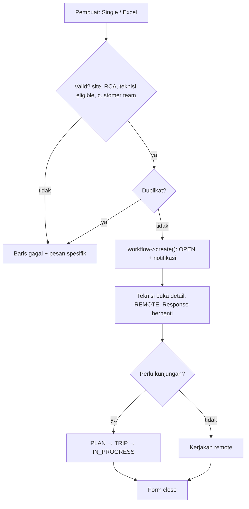
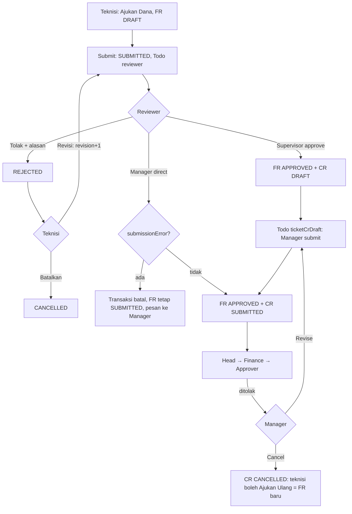
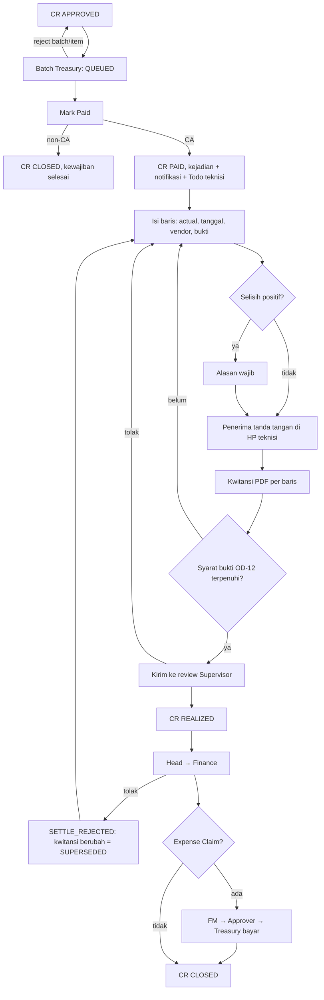
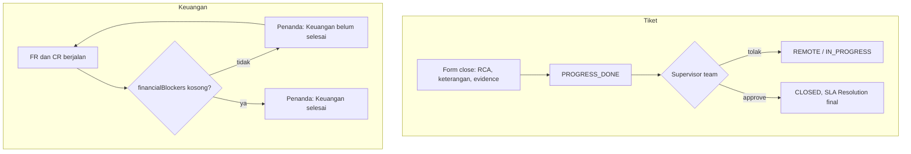

# Blueprint — Integrasi Trouble Ticket × Finance

**Status:** Disetujui pemilik (2026-11-06). F1–F9 sudah diimplementasikan di branch `update/v3.3.1` (belum di-commit, belum dimigrasi ke DB dev; test terkait dijalankan 2026-11-06: 181 dari 207 lolos, 26 sisanya gagal identik di baseline `1d3f7fe`). Antrean `ticketFinanceOpen` dari §7 tidak dibuat; tindakan teknisi tercakup `ticketFundingRevise` dan `ticketSettlementDue`.
**Peran:** Planner. **Branch acuan:** `update/v3.3.1` (`1d3f7fe`). **Tanggal audit:** 2026-11-06.
**Risiko keseluruhan:** CRITICAL (menyentuh jalur uang, otorisasi, dan penutupan tiket). Setiap fase HIGH/CRITICAL wajib disetujui sebelum dikerjakan (CLAUDE.md §20).

Istilah: **Funding Request (FR)** pada brief = **`TroubleTicketRequest`** yang sudah ada ("Pengajuan Biaya"). Tidak dibuat entitas baru.

Keterbatasan audit:
- Screenshot baseline yang disebut brief **tidak terlampir**. Bagian UI disusun dari kode, bukan dari gambar.
- `AGENTS.md` tidak ada di repo.
- Tidak ada test yang dijalankan dan tidak ada data produksi yang dibaca. Volume data dan isi Team produksi **UNKNOWN**.
- Halaman detail tiket tidak dibuka di browser pada audit ini.

---

## 0. Ringkasan untuk pengambil keputusan

**Temuan utama: jembatan yang direkomendasikan brief sudah ada dan berjalan.** Upgrade ini seharusnya berupa *penyempurnaan dan pengerasan*, bukan pembangunan baru.

| Sudah ada (bisa dipakai ulang) | Belum ada / salah |
|---|---|
| FR multi per tiket, revisi tanpa menghapus riwayat, tolak + alasan, batal | Manager tidak bisa me-review; tidak ada jalur CR langsung `SUBMITTED` |
| Approve → CR `DRAFT` (kunci baris + `budget_request_id` UNIQUE) | CR `DRAFT` dari tiket tidak masuk Todo siapa pun, dan supervisor tidak berhak submit |
| Kejadian `cost_request_paid` di timeline + notifikasi teknisi | Tidak ada tautan balik CR → tiket; status settlement tidak muncul di tiket |
| Modal settlement per baris + e-sign penerima dana + lampiran per baris | Teknisi hanya bisa simpan **draft**; belum ada kwitansi; berkas e-sign 403 |
| Layout 2 kolom, 6 tab, chat dengan input di bawah | Tinggi layout diduga salah hitung karena `zoom` 80% |
| Expense Claim, Second Payment, refund, kuota CA, Terbilang, `DocumentSequence` | Tidak ada PDF; kwitansi belum ada; tidak ada penanda keuangan pada tiket |

**Tiga rekomendasi, setelah keputusan pemilik:**
1. Operational vs Financial Closure → **dua hal terpisah, tanpa status tiket baru.** Tiket `CLOSED` saat masalah di site selesai, meski keuangan belum beres. Status keuangan dihitung dari FR & CR dan tampil sebagai penanda "Keuangan belum selesai".
2. FR sebagai jembatan → sudah demikian. CR tetap satu-satunya dokumen transaksi.
3. E-sign per line item → satu kwitansi digital per baris realisasi, ditandatangani **penerima uang** (mis. tukang ojek) di layar HP teknisi. Rantai audit: Ticket → CR → Item → Bukti → Kwitansi → Approval.

**Blocker tersisa:** audit data Team produksi, dan persetujuan dependensi dompdf setelah uji di Hostinger. OD prioritas sedang (§9) diputuskan saat fasenya tiba.

---

## 1. Deliverable 1 — Audit arsitektur saat ini

### 1.1 Trouble Ticket

| Aspek | Kondisi aktual | Bukti |
|---|---|---|
| Status | `OPEN, REMOTE, PLAN, TRIP, IN_PROGRESS, PROGRESS_DONE, CLOSED`; kolom `varchar(20)` | `TroubleTicket.php:90`, migrasi `200002:43` |
| Satu pintu transisi | `TroubleTicketWorkflow`: transaksi + `lockForUpdate` + cek status + kejadian timeline | `TroubleTicketWorkflow.php:41-57` |
| Penugasan | **Satu** teknisi (`assigned_to`); riwayat di `trouble_ticket_assignments` | `isTechnician()` :72 |
| Teknisi yang sah | PIC internal site, bukan leader team | `eligibleTechnicians()` :218 |
| Pembuat tiket | Semua pemegang menu kecuali `teknisi` | `AccessRoles::TROUBLE_TICKET_CREATE_DENIED` |
| Keterlihatan | Non-pengawas: hanya tiket yang ditugaskan. Pengawas: buatan sendiri, tugasnya, dan site PIC satu team | `scopeVisibleTo()` :354 |
| Form close | Semua yang bisa melihat tiket | `canClose()` :110 |
| Approve close | Role `supervisor`/`superadmin`, **tanpa cek team** | `canApproveClose()` :173 |
| Chat | Semua yang bisa melihat tiket | `canMessage()` :185 |
| Timeline | `trouble_ticket_messages`, immutable, idempoten via UNIQUE (`trouble_ticket_id`,`client_token`) | migrasi `200002:124` |
| Lampiran | Disk `secure`, sha256, unduh lewat controller | `docs/modules/trouble-ticket.md` |
| Buat tiket massal | Server menerima maks. 20 blok, berurutan tanpa transaksi bersama | `store()` :349, `MAX_TICKETS_PER_SUBMIT` |

### 1.2 Funding Request (`TroubleTicketRequest`)

- Tabel `trouble_ticket_requests`, `..._items`, `..._attachments` (`2026_10_21_000100`): revisi = baris baru, soft delete, `budget_request_id` UNIQUE tanpa FK.
- Status `DRAFT, SUBMITTED, APPROVED, REJECTED, CANCELLED`.
- Tidak punya nomor dokumen sendiri (`trouble-ticket.md:215`).
- `approveRequest()` :1224 membuat CR `DRAFT` lewat `buatDraftCostRequest()` :1347: `generateCode()`, `isNob()/nobOverage()`, salin lampiran, PNG ringkasan tiket. Applicant = reviewer.
- Reviewer `canReviewRequest()` :657: role `supervisor` satu team (leader **atau sesama anggota**), bukan pembuat.
- Form `mdlTtRequest` adalah modal tersendiri yang meniru form CR, dan **sengaja tanpa informasi budget** (`_pengajuan.blade.php:5`).

### 1.3 Cost Request

```
DRAFT →SUBMITTED →CHECKED →VERIFIED →APPROVED →QUEUED ─┬─ CA    → PAID → REALIZED → SETTLE_CHECKED → SETTLE_VERIFIED ─┬→ CLOSED
                                                       └─ nonCA → CLOSED                                             └→ SETTLE_APPROVED → SECOND_APPROVED → QUEUED → CLOSED
```

| Titik | Fakta | Bukti |
|---|---|---|
| `DRAFT → SUBMITTED` | Route **hanya** `superadmin,manager`. Supervisor tidak bisa submit | `web.php:762-763` |
| Syarat submit | CA: ≥1 lampiran global + kuota PIC. Non-CA: lampiran di tiap baris | `submit()` :2232 |
| Isi logika submit | Private di controller, tanpa kunci baris | :2232, `cashAdvanceQuotaError()` :262 |
| Non-CA | Dibayar → langsung `CLOSED`. **Tidak punya settlement** | `DailyTransactionController.php:1592`, `refundAmount()` |
| Refund | `amount − total_realization`; bukti transfer **opsional**; tidak ada alur penerimaan | `settlement.md:53,90` |
| Expense Claim | `total_realization − amount`, lewat FM → Approver → batch Treasury | `settlement.md:27-42` |
| Penghapusan | CR `DRAFT` bisa dihapus (soft) dan berkasnya hilang | `destroy()` :4150 |
| Titik log | `addLog()` dilewati hampir semua transisi; sudah menjadi hook audit | `BudgetRequest.php:1152` |

### 1.4 Settlement & e-sign

- Baris = `budget_request_realizations`, tertaut `request_detail_id`. Item bisa dipecah; ada baris tambahan tanpa item asal.
- Baris yang tidak dikirim ulang **dihapus beserta berkasnya** (`syncRealizations()` :738). FK lampiran baris `cascade`.
- Lampiran Item wajib saat submit untuk Settle > 0. Keterangan **tidak** wajib walau melebihi pengajuan (keputusan 4 Nov, `settlement.md:79-89`).
- Modal tiket hanya memanggil `save-realization-draft`. Route `submit-realization` terbuka untuk teknisi, tetapi **tidak ada UI**, dan responsnya redirect ke `budget-request.index`.
- E-sign = PNG coretan disimpan sebagai lampiran global `ttd-r<id>-<kode>.png` di folder `settlement_signatures/`, **dihapus dan diganti** saat dikirim ulang (:3512-3516). Tanpa autentikasi, hash, atau timestamp terikat.
- Kolom `settlement_signature_*` di `budget_request` tidak dipakai.

### 1.5 Treasury & notifikasi

- `markPaid()` :1477 mengunci batch; hook tiket dipanggil **di dalam transaksi** (:1605), jadi error di sisi tiket ikut membatalkan pembayaran.
- Jalur Second Payment `continue` di :1580, sehingga pelunasan Expense Claim tidak pernah sampai ke tiket.
- `NotifyService::send()` → `AppNotification`: lonceng sync, WhatsApp via antrean.
- Todo List berbasis **query status dokumen** (`TodoService::QUEUES` + `queueQuery()`), bukan tabel tugas. Item otomatis hilang setelah status berubah.
- Antrean tiket hanya satu: `ticketRequestReview`, role `superadmin, supervisor`.

### 1.6 Struktur organisasi

- `employees` **tidak terhubung** ke `users`. Identitas alur kerja = `users` (`docs/plans/2026-11-06-team-akses-organisasi.md` §3.1).
- Tidak ada `reports_to`. Hierarki hanya dari `teams.leader_id`, `team_members.level/position/is_primary`, `teams.parent_team_id`, dan penyambungan `TeamController::orgAttachments()` (private).
- K1: workflow tidak berubah. K3: hierarki **tidak mewariskan akses**. Keduanya berbenturan dengan sebagian brief (lihat OD-3, OD-4).

### 1.7 Komponen yang dipakai ulang

`TroubleTicketWorkflow`, `TroubleTicketRequest`, `BudgetRequest::settlementFormRows()`, `refundAmount()`, `expenseClaimAmount()`, `DocumentSequence`, `Terbilang`, `NotifyService`, `TodoService::QUEUES`, `FileAccess`, `tesys-evidence-stage.js`, `x-status`, `x-empty`, `x-drawer`, `TesysSearchableSelect`, pola template/preview Excel (`downloadSettlementTemplate()`, `ImportsMasterRecords`), pola kolom generated `active_*` (`trouble_ticket_visits`).

### 1.8 Bug dan celah yang ditemukan

| # | Temuan | Bukti | Level |
|---|---|---|---|
| B1 | Supervisor **mana pun** bisa approve/tolak penutupan tiket team lain lewat POST langsung | `canApproveClose()` :173 tanpa scope, controller :1039 tanpa `canView` | HIGH |
| B2 | Supervisor mana pun lolos `canReassignBy()` | :129 | HIGH |
| B3 | CR `DRAFT` dari tiket macet: supervisor tidak boleh submit, dan tidak ada antrean Todo `DRAFT` | `web.php:762`, `TodoService::QUEUES` | HIGH |
| B4 | Leader ber-role `manager`/`head` tidak bisa me-review, dan tim itu tidak punya reviewer sama sekali | `canReviewRequest()` :663, `requestReviewers()` :717 | HIGH |
| B5 | CR dibatalkan/dihapus membuat FR buntu: tetap `APPROVED`, tidak bisa diajukan ulang | `CANCELLABLE`, `budget_request_id` | HIGH |
| B6 | Reassign setelah dana cair memindahkan hak settlement ke teknisi baru. Teknisi lama (pemegang uang) kehilangan akses tiket | `isTicketTechnicianOfCr()` :3439 memakai `assigned_to` | HIGH |
| B7 | Berkas e-sign di `settlement_signatures/` tidak terdaftar di `FileAccess`, jadi `/storage` menolaknya | `FileAccess.php:63-131` (`default => false`) | MEDIUM |
| B8 | Teknisi tidak lolos `allowsCostRequest()` untuk bukti CR tiketnya sendiri bila belum pernah tercatat di log CR | `FileAccess.php:165` | MEDIUM |
| B9 | Kegagalan hook tiket bisa membatalkan transaksi Mark Paid | `DailyTransactionController.php:1605` | HIGH |
| B10 | Cek idempotensi `cost_request_paid` berupa scan metadata tanpa kunci; `syncCostRequestPaid()` saat buka tiket bisa balapan | `tulisKejadianDibayar()` :1530 | MEDIUM |
| B11 | `syncCostRequestPaid()` melewatkan `SETTLE_REJECTED`, `SETTLE_APPROVED`, `SECOND_APPROVED` | :1498 | LOW |
| B12 | Notifikasi "menunggu verifikasi" saat REALIZED dikirim ke Finance, padahal tahap berikutnya Head | `BudgetRequestController.php:3419` | LOW |
| B13 | `crBerasalDariTiket()` tidak dipanggil di mana pun (kode mati) | :3533 | LOW |
| B14 | Dokumen usang: `trouble-ticket.md` bagian Hak akses & "Belum masuk Todo List", `approval.md:42` "return to PAID", komentar `AccessRoles` | | LOW |

---

## 2. Deliverable 2 — Gap analysis

| Area | Kondisi | Perubahan | Risiko | Prioritas |
|---|---|---|---|---|
| Import Excel | Tidak ada; form hanya 1 blok | Template + preview + commit parsial | MEDIUM | P2 |
| Lampiran Create | Ada di form | Hapus dari form; server tetap menerima untuk integrasi | LOW | P3 |
| Otorisasi tiket | Global role; close/chat = semua yang melihat | Scope hierarki, pisah `canView` dari aksi | HIGH | **P1** |
| Layout detail | Sudah 2 kolom, tinggi diduga salah | Perbaiki `fitDetail()`, rapikan panel | LOW | P2 |
| Nomor FR | Tidak ada | `request_number` | MEDIUM | P2 |
| Manager direct approval | Tidak ada | Otoritas hierarki + CR `SUBMITTED` berbagi aturan `submit()` | **CRITICAL** | P1 |
| CR draft macet | Tidak ada antrean | Antrean `ticketCrDraft` | HIGH | **P1** |
| FR buntu | Tidak ada jalan | "Ajukan ulang" sebagai FR baru | MEDIUM | P2 |
| Tautan balik CR → tiket | Tidak ada | Tampil di drawer CR + filter | MEDIUM | P2 |
| Visibilitas Finance/Treasury | Tidak bisa melihat tiket | Baca-saja untuk tiket ber-CR | HIGH | P2 |
| Timeline finansial | Hanya `cost_request_paid` | Cermin `addLog()` + detail pembayaran | HIGH | P2 |
| Settlement dari tiket | Draft saja | Kirim resmi dari tiket | **CRITICAL** | P1 |
| Data per baris | Tanpa tanggal & vendor | Kolom aditif | MEDIUM | P2 |
| E-sign & kwitansi | Coretan tanpa nama penerima, tanpa PDF | Kwitansi digital per baris + PDF | MEDIUM | P2 |
| Status keuangan tiket | Tidak terlihat | Penanda terhitung + `financialBlockers()`, tanpa menahan penutupan | MEDIUM | P2 |
| Todo teknisi | Tidak ada | Antrean settlement & penugasan | MEDIUM | P3 |

---

## 3. Deliverable 3 — Arsitektur yang diusulkan

Mengikuti CLAUDE.md §3: tanpa Policy, Event/Listener, Repository, atau DTO. Otorisasi tetap di `TroubleTicketWorkflow`; hook tetap panggilan langsung seperti pola `addLog()`.

### 3.1 Relasi data

```text
trouble_tickets 1─N trouble_ticket_requests (FR)     [ada]
                       ├─1 N trouble_ticket_request_items (per revisi)   [ada]
                       └─1 0..1 budget_request (budget_request_id UNIQUE) [ada]
                                  ├─ request_detail 1─N budget_request_realizations [ada]
                                  │        └─ 1─N settlement_receipts (versi; 1 VALID)  [BARU]
                                  ├─ request_status_logs [ada]
                                  └─ budget_request_second_payments [ada]
```

Penelusuran dua arah memakai `TroubleTicket::forCostRequest()` yang sudah ada. **Tidak menambah kolom di `budget_request`.** Polymorphic tidak dipakai karena pasangannya hanya satu jenis.

### 3.2 Perubahan skema (semua aditif)

| # | Migrasi | Isi | Level |
|---|---|---|---|
| M1 | `add_request_number_to_trouble_ticket_requests` | `request_number` varchar(30) nullable UNIQUE. Data lama tetap NULL, tampil sebagai `#id` | MEDIUM |
| M2 | `add_settlement_review_to_trouble_ticket_requests` | `settlement_review_status`, `settlement_reviewed_by`, `settlement_reviewed_at`, `settlement_review_notes` (OD-3) | MEDIUM |
| M3 | `add_transaction_info_to_budget_request_realizations` | `transaction_date` date null, `vendor_name` varchar(150) null. Alasan selisih memakai `change_note` yang sudah ada | MEDIUM |
| M4 | `create_settlement_receipts_table` | Lihat §3.3 | MEDIUM |

Status keuangan tiket **tidak disimpan**: dihitung dari FR & CR (§4.4), sehingga tanpa kolom, tanpa backfill, dan tidak bisa basi.

Urutan: M1 → M3 → M2 → M4, satu per fase yang memerlukannya. Tidak ada backfill. Migrasi memakai guard `hasTable/hasColumn`, timestamp unik.

**Rollback:** `down()` menghapus kolom atau tabel baru. Mengikuti pola `2026_10_21_000100`, `down()` M4 **menolak berjalan bila tabel berisi data**, karena kwitansi adalah catatan keuangan.

### 3.3 `settlement_receipts`

Kwitansi biasa dalam bentuk digital (OD-10). Yang menandatangani adalah **penerima uang**, bukan pengguna TESYS, sehingga tidak ada autentikasi penanda tangan. Nilai pembuktiannya datang dari nota/foto, kwitansi, dan review berjenjang.

| Kolom | Catatan |
|---|---|
| `receipt_number` UNIQUE | `DocumentSequence`, format diputuskan di F8 |
| `budget_request_id` FK RESTRICT, `trouble_ticket_id` FK RESTRICT nullable | |
| `realization_id` **tanpa FK**, `request_detail_id` | Baris realisasi bisa dihapus `syncRealizations()`; kwitansi tidak boleh ikut hilang |
| `recipient_name` | Nama penerima uang, diisi teknisi |
| `amount` bigint unsigned, `purpose`, `transaction_date` | Integer rupiah, disalin saat tanda tangan |
| `signature_path`, `pdf_path` | Disk `secure`, folder `settlement_receipts/`, wajib didaftarkan di `FileAccess` |
| `signed_at`, `captured_by` | Waktu server dan teknisi yang memegang HP |
| `status` (`VALID`/`SUPERSEDED`), `active_realization_id` generated UNIQUE | Maksimal satu VALID per baris (pola `trouble_ticket_visits`) |

Bila nilai baris berubah setelah ditandatangani, kwitansi lama menjadi `SUPERSEDED` (tetap tersimpan) dan penerima menandatangani ulang. Kwitansi tidak pernah dihapus.

### 3.4 Perubahan kelas

| Berkas | Perubahan |
|---|---|
| `App\Services\TroubleTicketWorkflow` | `financialBlockers()`, `mirrorCostRequestLog()`, `submitSettlement()`, otoritas baru (`canApproveClose()`, `canReassignBy()`, `canClose()`, `canMessage()`, `canReviewRequest()`, `canManageRequest()`) |
| `App\Services\OrgHierarchy` **(baru)** | Memindahkan `orgAttachments()` dari `TeamController`; `directLeadersOf()`, `upperLeadersOf()`. Service biasa, bukan layer baru. Berkas ini perlu disetujui (§3 CLAUDE.md) |
| `App\Services\SettlementReceiptService` **(baru)** | Membuat dan menggantikan kwitansi, merender PDF |
| `BudgetRequest` | `submissionError(): ?string` hasil ekstraksi aturan `submit()`. Controller tetap memanggilnya sehingga perilaku tidak berubah. Hook di `addLog()` |
| `BudgetRequestController` | `submit()` memakai `submissionError()`; `showJson()` menambah `ticket`; `isTicketTechnicianOfCr()` memakai pemohon FR |
| `TroubleTicketController` | `importTemplate`, `importPreview`, `importCommit`, `settlementSubmit`, `settlementSign`, `receipt` |
| `TodoService`, `TodoListController` | Antrean baru (§7) |
| `FileAccess` | `settlement_receipts`, `settlement_signatures`, jalur teknisi tiket |
| `DailyTransactionController::markPaid()` | Hook dipindah ke `DB::afterCommit` + try/catch; tambah cabang Second Payment. **CRITICAL** |
| `TroubleTicket` | `financialState()`, `scopeFinanceOpen()`. Daftar, detail, dan export menampilkan penanda |

### 3.5 Route baru (di grup `trouble-ticket`, gerbang `menu:trouble-ticket`)

```text
GET  trouble-ticket/import/template         import.template
POST trouble-ticket/import/preview          import.preview
POST trouble-ticket/import/commit           import.commit
POST {ticket}/requests/{requestId}/resubmit requests.resubmit   (FR baru dari CR batal)
POST {ticket}/settlement/{crId}/submit      settlement.submit
POST {ticket}/settlement/{crId}/review      settlement.review
POST {ticket}/settlement/row/{realization}/sign  settlement.sign  (throttle)
GET  {ticket}/receipt/{receipt}             receipt
```

`approveRequest` menerima parameter `direct=1` untuk Scenario 2; tidak perlu route baru.

### 3.6 Titik integrasi kritis

**Manager direct approval (Scenario 2).** Tidak boleh sekadar menulis `status => 'SUBMITTED'`:

1. Di dalam transaksi `approveRequest()`, setelah `buatDraftCostRequest()`, panggil `$cr->submissionError()`. Bila ada error (kuota CA, lampiran), **seluruh transaksi batal** dengan pesan jelas. Tidak ada CR setengah jadi.
2. Tulis log dua langkah (`DRAFT→DRAFT created`, lalu `DRAFT→SUBMITTED submitted`), `submitted_at`, dan notifikasi Head **setelah commit**. Efeknya sama dengan `submit()`, sehingga Todo `head` dan Finance register berjalan seperti biasa.
3. Applicant = Manager. Hak ini hanya untuk role `manager` yang menjadi leader team teknisi atau team di atasnya (OD-4). Manager harus lolos `scopeByRole` CR tersebut (Access Group); bila tidak, ditolak. `scopeByRole` ada di trait controller, jadi cara pemanggilannya dari service ditentukan di F4.

Dampak status: `BudgetConsumption::NONE` memuat `DRAFT`, jadi `SUBMITTED` langsung mengonsumsi budget (COMMITTED). Karena itu Manager direct approval harus diperlakukan sebagai keputusan yang mengikat.

**Cermin status CR ke tiket.** Di `addLog()`, setelah log dibuat: bila CR tertaut tiket, tulis kejadian dengan `client_token = uuid v5 dari ID log`. UNIQUE yang sudah ada membuatnya idempoten tanpa kolom baru (`client_token` char(36)). Pencarian tautan dibungkus try/catch seperti `UserActivityLog`, sehingga **tidak pernah menggagalkan transaksi CR**. Biaya: satu query terindeks per `addLog()`, di-cache per instance CR.

**Otoritas review (OD-4, OD-5).** Reviewer = leader team teknisi, atau leader team di atasnya kapan saja. Pengambilalihan oleh leader atas dicatat di kejadian (`request_approved` dengan penanda `takeover`) dan leader team diberi tahu. Hasilnya mengikuti role reviewer: `manager` boleh memilih CR `SUBMITTED`; selain itu CR `DRAFT`.

**Keuangan selesai.** Saat CR terakhir masuk `CLOSED`/`CANCELLED`, cermin `addLog()` menulis kejadian `financial_closed` satu kali. Status tiket tidak berubah.

---

## 4. Deliverable 4 — Diagram alur

### 4.1 Pembuatan tiket & penugasan



### 4.2 Funding Request & approval



### 4.3 Finance, Treasury, settlement



### 4.4 Penutupan tiket dan status keuangan

Dua jalur yang berdiri sendiri (OD-1). Status tiket tidak menunggu Finance, dan alur SLA tidak berubah.



`financialBlockers()` per FR, dipakai untuk penanda dan daftar tindakan (**bukan** untuk menahan penutupan):

| Keadaan | Terbuka? | Tindakan yang ditampilkan |
|---|---|---|
| FR `DRAFT`, `SUBMITTED` | Ya | Ajukan/putuskan atau batalkan |
| FR `REJECTED` | Ya | Revisi atau batalkan |
| FR `CANCELLED` | Tidak | |
| CR `CLOSED`, `CANCELLED`, atau terhapus | Tidak | |
| CR lain | Ya | Status live + penanggung jawab tahap |

`financialState()`: `NONE` (tanpa dana), `OPEN`, `SETTLED`. CR lama (`trouble_tickets.budget_request_id`) ikut dinilai lewat `costRequestsOf()`.

Aturan OD-21: pada tiket `CLOSED`, pengajuan yang sudah ada masih bisa diajukan, direvisi, direview, dan dibatalkan, tetapi **tidak boleh membuat FR baru**. `canManageRequest()` dipisah dari `canRequest()` untuk ini. Settlement juga tetap jalan setelah tiket `CLOSED`.

---

## 5. Dampak penanda keuangan (MEDIUM)

Tidak ada status tiket baru, jadi `STATUSES`, SLA, `scopeOverdue()`, dan `closed_at` **tidak berubah**.

| Lokasi | Perubahan |
|---|---|
| `TroubleTicket` | `financialState()`, `scopeFinanceOpen()` (subquery FR/CR; memakai indeks yang ada) |
| Daftar tiket | Badge "Keuangan belum selesai" + filter. Relasi dimuat sekali per halaman (hindari N+1) |
| Header detail & tab Pengajuan Dana | Penanda + daftar blocker |
| Export tiket | Kolom status keuangan |
| `TroubleTicketMessage::EVENTS` | `financial_closed` dan kejadian CR baru |

---

## 6. Deliverable 5 — Matriks hak akses

Otoritas dihitung dari **penugasan dan Team saat ini**, selalu di server. Sel bertanda ⚠ menunggu OD.

**Definisi:** *Teknisi* = `assigned_to`. *Pemohon* = `requested_by`. *Atasan langsung* = leader team ACTIVE tempat teknisi menjadi anggota ACTIVE. *Manager berwenang* = role `manager` yang menjadi leader team teknisi atau team di atasnya (OD-4). *Pengawas* = atasan langsung, Manager berwenang, atau superadmin.

| Aktivitas | Pembuat/NOC | Teknisi | Atasan langsung | Manager berwenang | Finance group | Treasury |
|---|---|---|---|---|---|---|
| Buat tiket / import | Ya | Tidak | Ya | Ya | Sesuai menu | Sesuai menu |
| Lihat tiket | Tiket buatannya (6 Nov) | Ditugaskan, atau pemohon FR aktif | Team-nya | Scope-nya | Baca, tiket ber-CR | Sama |
| Progres teknis | Tidak | Ya | Plan/reassign | Plan/reassign | Tidak | Tidak |
| Chat | Ya (OD-7, 6 Nov) | Ya | Ya | Ya | Baca | Baca |
| Buat FR | Tidak | Ya | Tidak | Tidak | Tidak | Tidak |
| Review FR | Tidak | Tidak | Ya → CR DRAFT | Ya → CR SUBMITTED | Tidak | Tidak |
| Review FR sebagai leader atas | Tidak | Tidak | Ya, tercatat ambil alih | Ya, tercatat ambil alih | Tidak | Tidak |
| Lihat CR tertaut | Tidak | Baca (pemohon) | Sesuai `scopeByRole`; dokumen uang tiket (kwitansi, lampiran CR) sebagai peninjau settlement | Sama dengan atasan langsung | Ya | Sesuai menu |
| Proses Finance | Tidak | Tidak | Tidak | Submit, revise | Alur CR | Tidak |
| Bayar | Tidak | Tidak | Tidak | Tidak | Grup Treasury | Ya |
| Isi settlement & ambil tanda tangan penerima | Tidak | **Pemohon saja** | Tidak | Tidak | Tidak | Tidak |
| Review settlement | Tidak | Tidak | Ya, sebelum kirim ke CR | Ya, sebelum kirim ke CR | Alur CR | Baca |
| Form close | Tidak | Ya | Ya | Ya | Tidak | Tidak |
| Approve close | Tidak | Tidak | Ya | Ya | Tidak | Tidak |
| Lihat kwitansi | Tidak | Miliknya | Team-nya | Scope-nya | Ya | Baca |

Superadmin tetap penuh, kecuali aturan "bukan pembuat".

**Syarat rekayasa wajib:** memperluas `scopeVisibleTo()` otomatis memperluas `canClose()` dan `canMessage()`, karena keduanya bersandar pada `canView()`. Karena itu kedua method tersebut **harus dipisah lebih dulu** sebelum Finance diberi akses baca.

---

## 7. Todo, notifikasi, dan log

| Jenis | Sumber | Sifat |
|---|---|---|
| Todo | Query status (`TodoService::QUEUES`) | Hilang sendiri setelah status berubah. Tidak ada tabel tugas |
| Notifikasi | `NotifyService` | Informasi sekali kirim |
| Log | `trouble_ticket_messages`, `request_status_logs`, `user_activity_logs` | Permanen |

| Antrean baru | Penangan | Isi | Tautan |
|---|---|---|---|
| `ticketAssigned` | Teknisi | Tiket `OPEN` miliknya | detail tiket |
| `ticketFundingRevise` | Pemohon | FR `REJECTED` | `?tab=pengajuan` |
| `ticketCrDraft` | Manager (scope CR) | CR `DRAFT` hasil FR | drawer CR |
| `ticketSettlementDue` | Pemohon | CR `PAID`/`SETTLE_REJECTED` | `?tab=pengajuan&settle=id` |
| `ticketSettlementReview` | Pengawas | Settlement menunggu review | tab Pengajuan |
| `ticketCloseApprove` | Atasan | Tiket `PROGRESS_DONE` | detail tiket |
| `ticketFinanceOpen` | Pemohon | Tiket `CLOSED` dengan keuangan terbuka yang menunggu aksi teknisi | tab Pengajuan |

Sistem saat ini **tidak punya konsep due date**. Yang tersedia: usia dokumen (`respontime`) dan pengingat `todo:remind`. Due date sungguhan adalah fitur baru dan **tidak** dimasukkan ke rencana ini.

Teknisi perlu menu `todo-list`, atau antreannya ditampilkan di Daftar Tiket. Menu ini diatur manusia di User & Access.

Isi notifikasi pembayaran: No. tiket, No. FR, No. CR, nilai dibayar, tanggal, referensi (kode batch + `payment_notes`), status Treasury. Idempotensi lewat `client_token` (B10). Notifikasi hanya dikirim bila kejadian baru benar-benar tertulis.

---

## 8. Deliverable 6 — Blueprint UI/UX

Mengikuti `tesys-frontend-ui`: token CSS, komponen yang ada, tanpa gradien atau kartu berlebih, teks Indonesia.

### 8.1 Akar masalah "chat pendek, ruang kosong di bawah" (terbukti dan diperbaiki di F2: celah 166px menjadi 9,6px pada layar 900px)

`fitDetail()` (`show.blade.php:1628`) menghitung tinggi dari `window.innerHeight` dan `getBoundingClientRect()`, lalu menulisnya sebagai `style.height`. Di ≥901px, `html` memakai `zoom: .8` (`tesys-ui-shell.css:66`), sehingga nilai itu digambar 80%. Hasilnya panel kira-kira 20% lebih pendek dari ruang tersedia, cocok dengan keluhan brief.

Masalah sejenis sudah terbukti dan diperbaiki pada garis bagan Organisasi (rilis v3.3.0). **Perbaikan utamanya kecil:** membagi dengan rasio `rect.height / offsetHeight`. Redesain besar tidak diperlukan. Kelas `.tt-pane-chat .tt-fill` di `_assets.blade.php:294` memakai `vh` dan perlu diperiksa pada lebar 901–991px.

### 8.2 Halaman detail

```text
┌ T.1126008  [In Progress]  Site · Customer ──────────────── stepper tahap ┐
├───────────── Percakapan & Aktivitas ──────┬─ Summary Site Ticket SLA Dana Log ┤
│ ▲ muat lebih lama                         │  (scroll sendiri)                │
│ ● Budi 10:12  Sudah tiba di site          │  Panel tahap / aksi              │
│ ─ Sistem: Pengajuan FR-1126-012 disetujui │  ...                             │
│ ─ Sistem: CR-… dibayar Rp1.000.000        │                                  │
│ (scroll sendiri)                          │                                  │
├───────────────────────────────────────────┤                                  │
│ [📎] Tulis pesan…                 [Kirim] │                                  │
└───────────────────────────────────────────┴──────────────────────────────────┘
```

Enam tab sudah ada. Perubahannya: "Pengajuan" berganti nama menjadi **Pengajuan Dana**, kejadian finansial diberi gaya pembeda di timeline, dan tiket dengan keuangan terbuka menampilkan penanda serta daftar blocker, termasuk saat sudah `CLOSED`. HP tetap memakai pola panel yang ada.

### 8.3 Tab Pengajuan Dana

```text
Ringkasan  Diajukan 2.500.000 · Dibayar 1.000.000 · Settle 1.070.000 · Selisih +70.000
FR-1126-012  [Disetujui]  rev 2 · Budi · 06 Nov
  ● Review → ● CR → ● Finance → ● Dibayar → ○ Settlement → ○ Selesai
  CR-1126… [Paid]   Rp1.000.000   [Settlement]  [Riwayat]
```

Nilai CR ditampilkan **live**, karena Manager atau Finance bisa mengubah dan melakukan takeout. Bila berbeda dari total FR, keduanya ditampilkan.

### 8.4 Create & Bulk Import

- Create: hapus field lampiran (`create.blade.php:95`), tambah tombol **Import Excel**.
- Import 3 langkah: Unduh template → Unggah & pratinjau → Konfirmasi.
- Pratinjau: tabel baris dengan status Valid / Gagal / Duplikat dan pesan per baris. Tombol "Buat N tiket valid".
- Ringkasan akhir: berhasil, gagal, dan unduhan baris gagal.

### 8.5 Form Funding Request

Modal `mdlTtRequest` dipertahankan (OD-14), ditambah blok konteks baca-saja: No. tiket, Customer, Site, Teknisi. Isian "Keperluan" memakai `description` yang sudah ada.

### 8.6 Settlement per baris

```text
Item            Request   Actual   Selisih   Tanggal  Vendor  Bukti  Tanda tangan
Transportasi    500.000  600.000  +100.000  05/11    Gojek   2 📎   ✓ KW-…  [Lihat]
  Alasan selisih: Tarif naik karena hujan (wajib)
Konsumsi        150.000  120.000   -30.000  05/11    —       1 📎   [Tanda tangani]
Total         1.000.000 1.070.000  +70.000
[Simpan Draft]                                  [Kirim Settlement] (aktif bila lengkap)
```

Kolom Request dan Selisih dihitung server dari `settlementFormRows()`. Ambang kirim mengikuti `validateRealizationInput()` yang sudah ada. Di HP, baris menjadi kartu.

### 8.7 Kwitansi digital

Di lapangan: teknisi mengisi **Nama penerima** → menyerahkan HP → penerima mencoret di pad → **Simpan**. Pad `mdlTtEsign` yang ada dipakai ulang; layarnya menampilkan nilai dan keperluan dalam huruf besar supaya penerima tahu apa yang ia tanda tangani. Hasilnya tampil lewat `tesys-evidence-stage` (PDF iframe) dengan tombol Unduh. Status `SUPERSEDED` ditandai jelas dan tetap bisa dibuka.

---

## 9. OPEN DECISIONS

**Sudah diputuskan pemilik (2026-11-06).**

| ID | Keputusan | Dampak pada rancangan |
|---|---|---|
| **OD-1** | Tiket boleh `CLOSED` saat masalah di site selesai, walau keuangan belum settle. Closed tiket ≠ closed keuangan | Tanpa status baru, SLA tidak berubah. Brief §10 "cegah closure" **tidak** diterapkan |
| **OD-2** | Settlement hanya Cash Advance | Non-CA selesai saat dibayar; non-CA tidak punya kwitansi digital |
| **OD-3** | Supervisor me-review sebelum kirim | Tanpa status CR baru; supervisor meneruskan ke `REALIZED` |
| **OD-4** | Manager = leader team atas | Lihat catatan interpretasi di bawah |
| **OD-5** | Leader team; leader atasnya boleh mengambil alih **kapan saja**, tercatat | Sesama anggota tidak lagi bisa me-review. Tidak perlu pencatatan cuti |
| **OD-6** | Form Close: teknisi + pengawas | Membalik keputusan 20 Okt 2026 |
| **OD-8** | Finance & Treasury baca-saja tiket ber-CR | Menu tetap diberikan manusia; `canClose`/`canMessage` wajib dipisah dulu |
| **OD-9** | dompdf | Perlu uji di Hostinger (§10 F8) |
| **OD-10** | E-sign = tanda tangan **penerima uang** di HP teknisi, seperti kwitansi biasa. Tanpa keamanan ketat | Tanpa password, HMAC, atau hash. Menggantikan brief §9 bagian keamanan |
| **OD-21** | Pengajuan terbuka tetap bisa diselesaikan setelah tiket `CLOSED`, dengan tanda keuangan belum closed | FR baru tetap tidak boleh |

**Interpretasi yang sudah dikonfirmasi pemilik:**
- OD-4: role `manager` yang menjadi leader team teknisi **sendiri** juga boleh direct approve (bukan hanya leader team di atasnya). Alasannya, brief Scenario 2 menyebut Manager sebagai atasan.
- OD-5: leader atas yang bukan role `manager` menghasilkan CR `DRAFT`; hanya role `manager` yang menghasilkan `SUBMITTED`.

**Diterapkan mengikuti rekomendasi, menunggu konfirmasi pemilik (instruksi "lanjutkan semua", 6 Nov 2026).**

| ID | Pertanyaan | Rekomendasi |
|---|---|---|
| OD-7 | Chat non-teknisi | **Diputuskan 6 Nov 2026:** teknisi, pengawas, dan pembuat tiket boleh chat (bukti NOC lewat chat; pembuat kembali melihat tiket buatannya, membatalkan sebagian keputusan 15 Okt); Finance, Treasury, dan lainnya baca-saja, juga ditolak di server |
| OD-11 | Alasan selisih wajib? Keputusan 4 Nov mencabutnya | Wajib per baris **hanya untuk CR dari tiket** |
| OD-12 | Kapan kwitansi wajib? Tidak semua transaksi punya penerima yang bisa tanda tangan (tol, minimarket), dan nota sudah wajib bila Settle > 0 | Tiap baris bernilai wajib punya nota **atau** kwitansi digital, hanya untuk CR tiket. Mengubah `submitRealization()`: HIGH |
| OD-13 | Multi-teknisi | Tetap satu `assigned_to`. Multi-teknisi menyentuh SLA, keterlihatan, dan semua gerbang |
| OD-14 | Brief: pakai form Create CR apa adanya; keputusan Okt: teknisi tidak melihat budget | Pertahankan modal. Form CR 1.637 baris dan menampilkan sisa budget, NOB, serta kuota |
| OD-15 | Bukti pengembalian sisa dana. Tidak ada alur penerimaan refund | Wajib untuk CR tiket bila Settle < pengajuan; verifikasi di tahap Finance. Alur kas masuk resmi di luar cakupan |
| OD-17 | Definisi duplikat import | No. tiket custom sama, atau site + RCA + tanggal sama pada tiket yang masih terbuka: **peringatan**, bukan penolakan otomatis |
| OD-18 | Batas import | 500 baris per berkas; teknisi wajib diisi dan eligible |
| OD-19 | Identitas perusahaan di kwitansi | Pakai sumber `$company` Cash Receipt; pilihan entitas ditentukan Finance. Alamat saat ini tertulis tetap di view |
| OD-20 | Reassign saat ada dana berjalan | Hak settlement ikut pemohon FR; teknisi lama tetap melihat tiket selama dana terbuka. **6 Nov 2026:** pengajuan yang belum jadi CR (DRAFT/SUBMITTED/REJECTED) dibatalkan otomatis saat reassign |

### 9.1 Batas kwitansi digital

- Kwitansi ini setara kwitansi kertas: membuktikan transaksi secara internal, bukan identitas penerima. Kontrolnya adalah nota/foto dan review Supervisor, Head, dan Finance.
- Kwitansi bernilai di atas ambang bea meterai mungkin terkena kewajiban meterai. **Perlu konfirmasi Finance.**

---

## 10. Deliverable 7 — Roadmap

Urutan brief disesuaikan: otoritas harus beres sebelum dana, dan F3 mengecil karena FR sudah ada. Satu fase = satu branch `feature/*`, dengan review tersendiri.

| Fase | Cakupan | Level | Bergantung |
|---|---|---|---|
| F0 | Blueprint disetujui, OD prioritas tinggi diputuskan, audit data Team produksi | — | — |
| F1 | Pengerasan otorisasi (B1, B2, B7, B8), pisah `canView`/aksi, `OrgHierarchy` | HIGH | OD-7, audit Team |
| F2 | Perbaikan tinggi layout, rapikan detail, hapus lampiran Create | LOW | — |
| F3 | Bulk Import | MEDIUM | OD-17,18 |
| F4 | FR: nomor (M1), konteks form, FR buntu (B5), Todo `ticketCrDraft` (B3), tautan balik | HIGH | F1 |
| F5 | Manager direct approval → CR `SUBMITTED` | **CRITICAL** | F1, F4 |
| F6 | Cermin status, notifikasi pembayaran, `markPaid` afterCommit (B9, B10, B11) | **CRITICAL** | F4 |
| F7 | Settlement dari tiket (M3, M2), pemilik = pemohon (B6) | **CRITICAL** | OD-11,15,20 |
| F8 | Kwitansi digital (M4) | MEDIUM | F7, OD-12 |
| F9 | Penanda keuangan, `financialBlockers`, FR pada tiket `CLOSED`, antrean Todo sisanya | MEDIUM | F6, F7 |
| F10 | QA regresi, UAT, dokumen, changelog | — | Semua |

F2 dan F3 bisa berjalan paralel dengan F1 karena berkasnya berbeda, kecuali `TroubleTicketController` (tetap satu per satu).

### Rincian fase

**F1 — Otorisasi.**
- Berkas: `TroubleTicketWorkflow`, `TeamController`, `Services/OrgHierarchy` (baru), `FileAccess`, `AccessRoles`, `_stage`, `show`, `TodoListController::queueQuery()`.
- DB: tidak ada.
- Risiko: supervisor kehilangan akses tiket yang selama ini ia tutup; butuh data Team yang benar.
- Terima: POST `close/approve` oleh supervisor team lain → 403; tombol, route, dan server sejalan; teknisi membuka lampiran CR tiketnya.
- Test: `TroubleTicketAuthorizationTest` (baru), `SecureFileAccessTest`.
- Rollback: revert kode.

**F2 — UI detail.**
- Berkas: `show`, `_assets`, `create`, `_pengajuan`.
- DB: tidak ada. Risiko rendah.
- Terima: pada 1366×768 dan 1920×1080 panel menyentuh dasar area kerja, tanpa scroll halaman, chat dan panel kanan scroll sendiri; layar 375px tidak melebar; konsol bersih.
- Test: verifikasi browser; test `create` tetap lulus untuk integrasi.
- Rollback: revert.

**F3 — Import.**
- Berkas: `TroubleTicketController`, `trouble-ticket/_import*`, route.
- DB: tidak ada. Pratinjau **stateless**: commit memvalidasi ulang isi berkas; `import_token` lewat `Cache::add` mencegah kirim ganda.
- Tiap baris memanggil `workflow->create()` dalam transaksinya sendiri, sehingga parsial aman dan notifikasi sama. Pengiriman WhatsApp massal bergantung worker (`docs/DEPLOYMENT.md`).
- Scope customer yang kini di `store()` dipindah ke helper bersama.
- Terima: template memuat data validation master; baris cacat tidak membuat tiket; klik ganda tidak menggandakan.
- Test: `TroubleTicketImportTest` (valid, invalid, duplikat, parsial, kirim ganda, otorisasi, batas baris).
- Rollback: revert; tiket yang sudah terbuat tetap sah.

**F4 — FR.**
- Berkas: workflow, `BudgetRequestController::showJson`, drawer CR, `TodoService`, `TodoListController`, `_pengajuan*`.
- DB: M1.
- Risiko: nomor dan antrean baru; drawer CR dipakai banyak halaman.
- Terima: FR baru bernomor; CR dari tiket terlihat di Todo Manager; drawer CR menaut tiket, yang tidak berhak tidak melihat tautan; CR batal → tombol Ajukan Ulang membuat FR baru, FR lama utuh.
- Test: tambah pada `TroubleTicketRequestTest`, `CostRequestWorkflowTest`.
- Rollback: `down()` M1.

**F5 — Manager direct.**
- Berkas: `BudgetRequest::submissionError()`, `submit()`, workflow, modal keputusan.
- DB: tidak ada.
- Risiko: **CRITICAL**, karena memindahkan aturan submit. Ekstraksi harus murni tanpa perubahan perilaku dan dirilis dengan test karakterisasi.
- Terima: CA melebihi kuota → transaksi batal, tanpa CR; sukses → status, log, `submitted_at`, antrean Head, dan notifikasi identik dengan submit manual; approve ganda → satu CR.
- Test: `CostRequestWorkflowTest`, `BudgetConsumptionTest`, skenario baru.
- Rollback: revert; CR yang sudah terbentuk adalah CR normal.

**F6 — Visibilitas.**
- Berkas: `BudgetRequest::addLog`, workflow, `DailyTransactionController::markPaid`, `_messages`, `_log`, `TroubleTicketMessage`.
- DB: tidak ada.
- Risiko: **CRITICAL** karena menyentuh `markPaid`. Perubahan dibatasi pada pemindahan hook; tidak ada logika uang yang berubah.
- Terima: gagal menulis kejadian tiket tidak membatalkan Paid; dua pemanggilan = satu kejadian; pelunasan Second Payment muncul di tiket.
- Test: tambah test `markPaid`, duplikasi, kegagalan hook.
- Rollback: revert.

**F7 — Settlement.**
- Berkas: `BudgetRequestController` (`from_ticket` pada `submitRealization`, `isTicketTechnicianOfCr`), `validateRealizationInput`, workflow, `_settle_row`, modal.
- DB: M3, M2.
- Risiko: **CRITICAL**. Rumus `refundAmount()`, `expenseClaimAmount()`, dan `total_realization` **tidak diubah**.
- Terima: tabel contoh brief menghasilkan +70.000 dari rumus yang ada; dua kirim bersamaan hanya satu `REALIZED` (kunci baris; ini perubahan locking dan butuh approval); teknisi lain 403; teknisi lama tetap bisa settle sesudah reassign.
- Test: exact, under, over, tanpa bukti, ganda, tolak-revisi, lintas teknisi.
- Rollback: `down()` kolom; data baris tetap sah.

**F8 — Kwitansi digital.**
- Berkas: `SettlementReceiptService`, `FileAccess`, pad `mdlTtEsign`, view kwitansi, `composer.json` (dompdf).
- DB: M4.
- Langkah pertama: uji dompdf di Hostinger pada branch terpisah. Bila gagal, kembali ke keputusan OD-9.
- Risiko: dependensi hosting; PDF memakan memori. Generate satu kwitansi per permintaan, sinkron.
- Terima: nama penerima + tanda tangan menghasilkan PDF berisi nomor, tiket, CR, nilai, terbilang, tanggal, keperluan; ubah nilai → versi lama `SUPERSEDED` tetap bisa dibuka; orang tak berhak 403; terbilang benar.
- Test: `SettlementReceiptTest`, `SecureFileAccessTest`.
- Rollback: fitur dimatikan; tabel tetap ada, `down()` menolak bila berisi.

**F9 — Penanda keuangan.**
- Berkas: `TroubleTicket`, workflow (`canManageRequest`), index, export, `_pengajuan`, `TodoService`, `TodoListController`.
- DB: tidak ada.
- Risiko: subquery di daftar tiket; ukur dengan data nyata.
- Terima: tiket `CLOSED` dengan CR berjalan tampil berpenanda dan terfilter; penanda hilang saat CR terakhir selesai; FR terbuka bisa diselesaikan setelah `CLOSED`, FR baru ditolak; tiket tanpa dana tanpa penanda; SLA tiket tidak berubah.
- Test: `TroubleTicketFinanceStateTest`.
- Rollback: revert.

---

## 11. Rencana test

Semua test dijalankan atas permintaan pengguna dan setelah prosedur §4.3 CLAUDE.md. Fokus regresi: `CostRequestWorkflowTest`, `CostRequestAccessTest`, `BudgetConsumptionTest`, `SecureFileAccessTest`, `TroubleTicketTest`, `TroubleTicketRequestTest`.

| Kelompok | Skenario |
|---|---|
| Ticket | single; import valid/invalid/duplikat/parsial/kirim ganda; customer-site-teknisi tidak valid; reassign; akses tanpa hak; chat & lampiran |
| FR | satu baris; banyak baris; banyak FR; supervisor → DRAFT; manager → SUBMITTED; tolak & ajukan ulang; approve ganda; validasi hierarki; CR batal → FR baru |
| Finance | CR masuk Todo; approval tetap; batch; bayar; notifikasi sekali; pembayaran tidak ganda. Partial payment **tidak ada** di TESYS, jadi tidak diuji |
| Settlement | pas, kurang, lebih, tanpa bukti, multi bukti, kwitansi, PDF, tolak, revisi, kirim ganda, sisa dana |
| Closure & keuangan | close tanpa dana; close dengan dana terbuka (berhasil + penanda); FR terbuka setelah CLOSED; FR baru ditolak; penanda hilang saat CR selesai; close tanpa hak |
| Keamanan | URL langsung; lintas teknisi; lintas team; approve tanpa hak; ambil alih leader atas; aksi finansial tanpa hak; berkas tanpa hak |
| Non-fungsional | N+1 tab Pengajuan; pagination chat (sudah ada); memori import 500 baris; waktu generate PDF; layout 375/768/1366/1920 |

---

## 12. Deliverable 8 — Risk register

| Risiko | Level | Mitigasi |
|---|---|---|
| CR ganda | CRITICAL | Kunci tiket + FR, cek `budget_request_id`, UNIQUE (ada). Test approve ganda |
| Pembayaran ganda | CRITICAL | Tidak ada perubahan logika `markPaid`; kunci batch tetap |
| Hierarki approval salah | HIGH | `OrgHierarchy` tunggal, audit Team sebelum F1, tanpa hardcode, pesan "tidak ada atasan" |
| Tiket tanpa reviewer | HIGH | Peringatan saat submit + fallback superadmin; laporan teknisi tanpa team |
| Akses tidak sah | HIGH | Otorisasi server di tiap aksi; test URL langsung; `canView` dipisah sebelum diperluas |
| Workflow Finance rusak | CRITICAL | Tanpa status CR baru; `submissionError()` dengan test karakterisasi; hook gagal-aman |
| Settlement yatim | HIGH | Kwitansi menyimpan snapshot, `realization_id` tanpa FK; tolak baris yatim (sudah ada) |
| Saldo salah | CRITICAL | Tidak ada rumus baru; memakai `refundAmount()`/`expenseClaimAmount()` |
| Notifikasi hilang/ganda | MEDIUM | `client_token`, jaring pengaman saat tiket dibuka, worker dipantau (`project_queue_worker_hostinger`) |
| Tiket CLOSED dengan dana terlupakan | HIGH | Penanda + filter + Todo pemohon; laporan tiket berdana terbuka untuk Finance |
| Kwitansi dipalsukan teknisi | MEDIUM | Wajib nota/foto (OD-12), review Supervisor, Head, dan Finance; `captured_by` tercatat |
| Data lama | MEDIUM | Tanpa backfill; nullable; tiket CLOSED tidak disentuh; CR non-tiket tidak berubah |
| Koneksi MySQL habis di hosting | HIGH | Tanpa query per baris; cache per instance; polling chat tidak ditambah; PDF sinkron per baris |
| Lingkup terlalu besar | HIGH | Fase kecil, satu branch, reviewer per fase, bisa berhenti di tiap fase |

---

## 13. Potential future improvement (di luar cakupan)

- FK `trouble_ticket_requests.budget_request_id` setelah audit data yatim.
- Alur kas masuk resmi untuk refund.
- Due date Todo.
- Relasi `employees` ↔ `users`.
- Perbaikan B12 dan B13, serta sinkronisasi dokumen usang (B14).

## 14. Definition of Ready untuk Execution

- [x] Blueprint disetujui (2026-11-06).
- [x] OD prioritas tinggi diputuskan (2026-11-06).
- [x] Interpretasi OD-4 dan OD-5 di §9 dikonfirmasi (2026-11-06).
- [ ] Data Team produksi diaudit (leader, parent, anggota, role).
- [ ] dompdf lolos uji di Hostinger (sebelum F8).
- [ ] Screenshot baseline diterima untuk F2.
- [ ] Finance mengonfirmasi §9.1.
